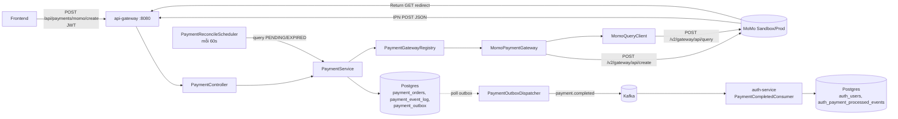
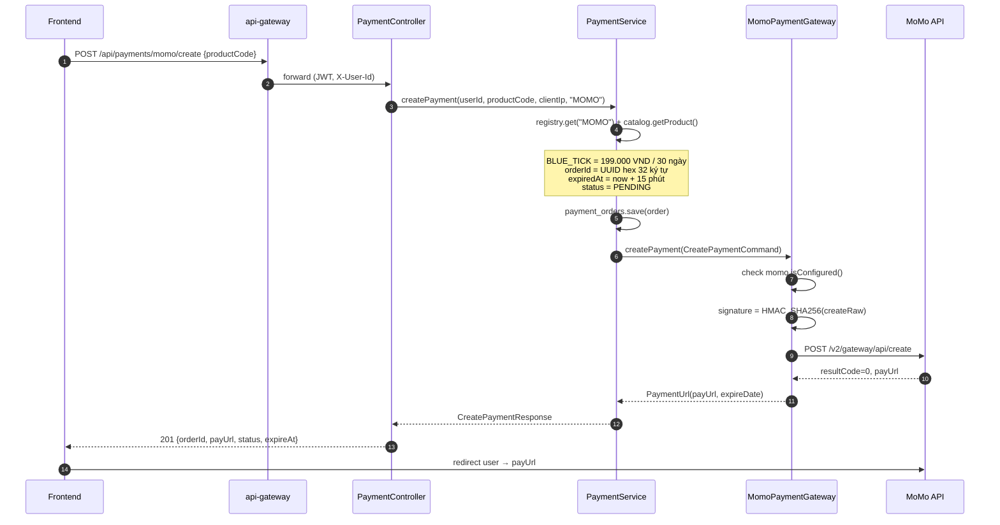
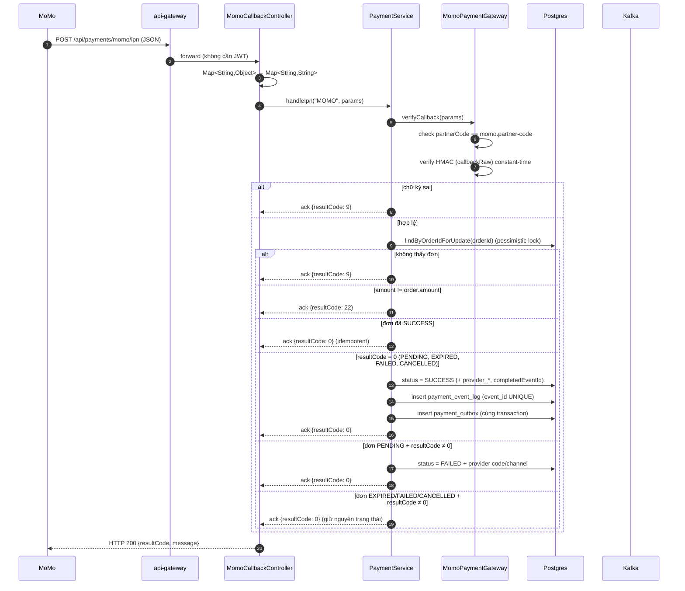
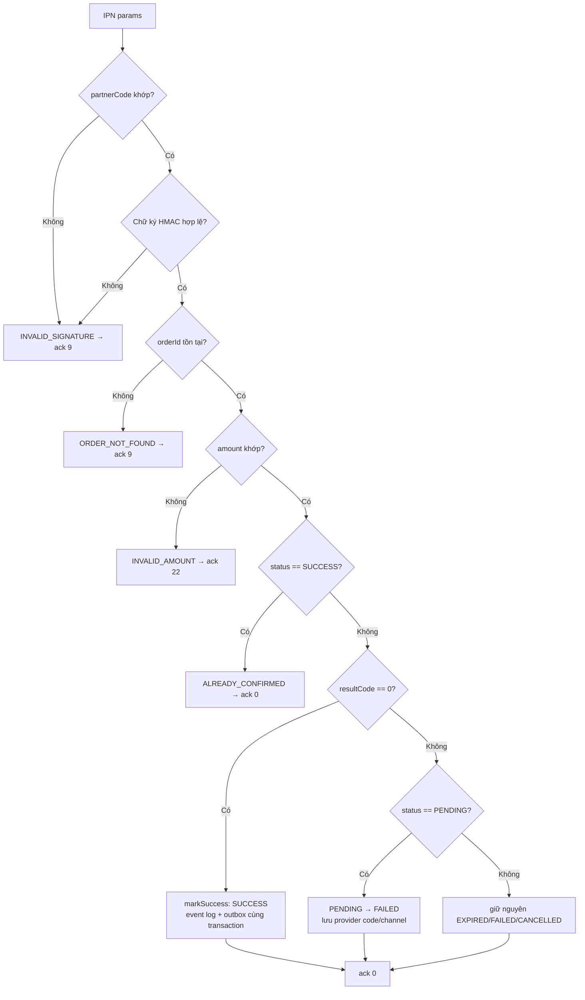
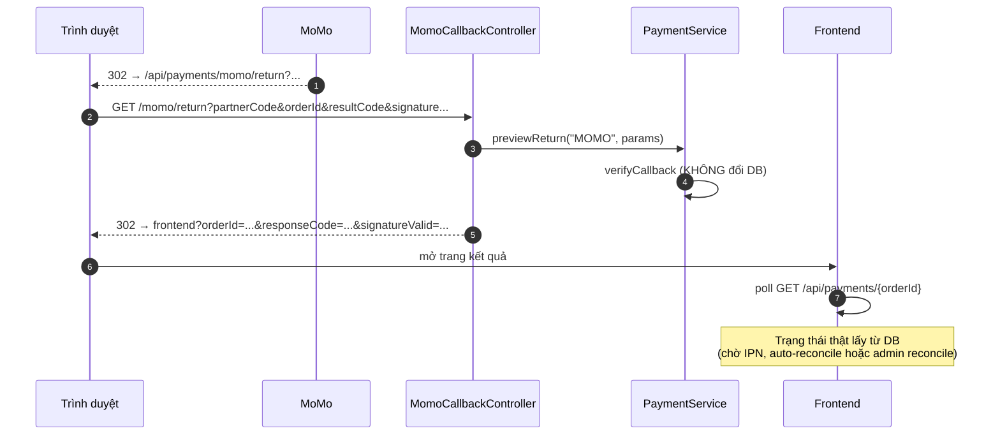
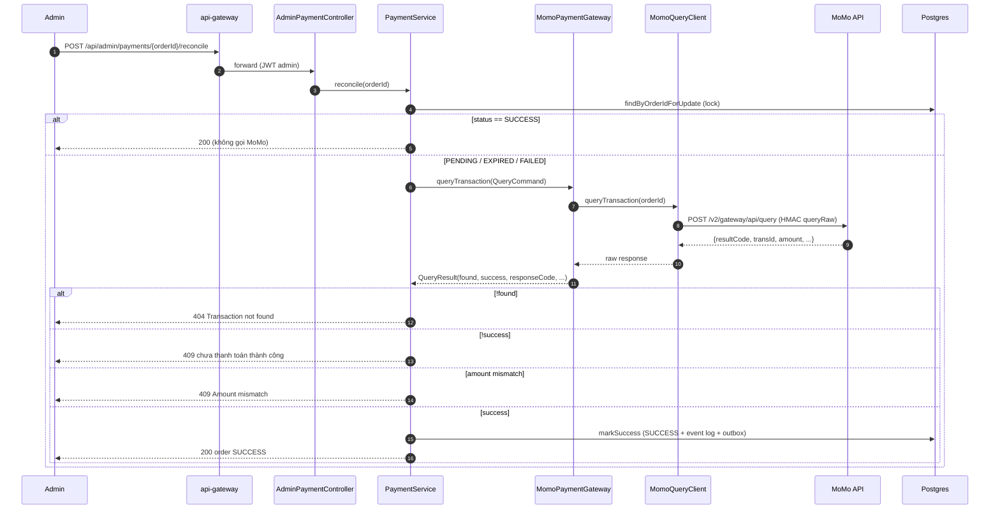
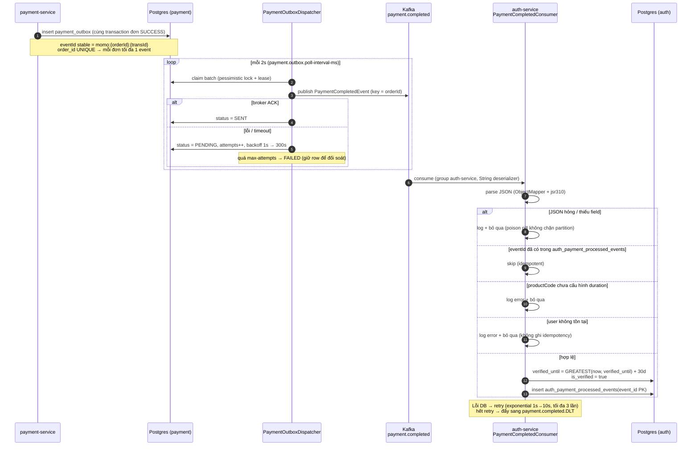
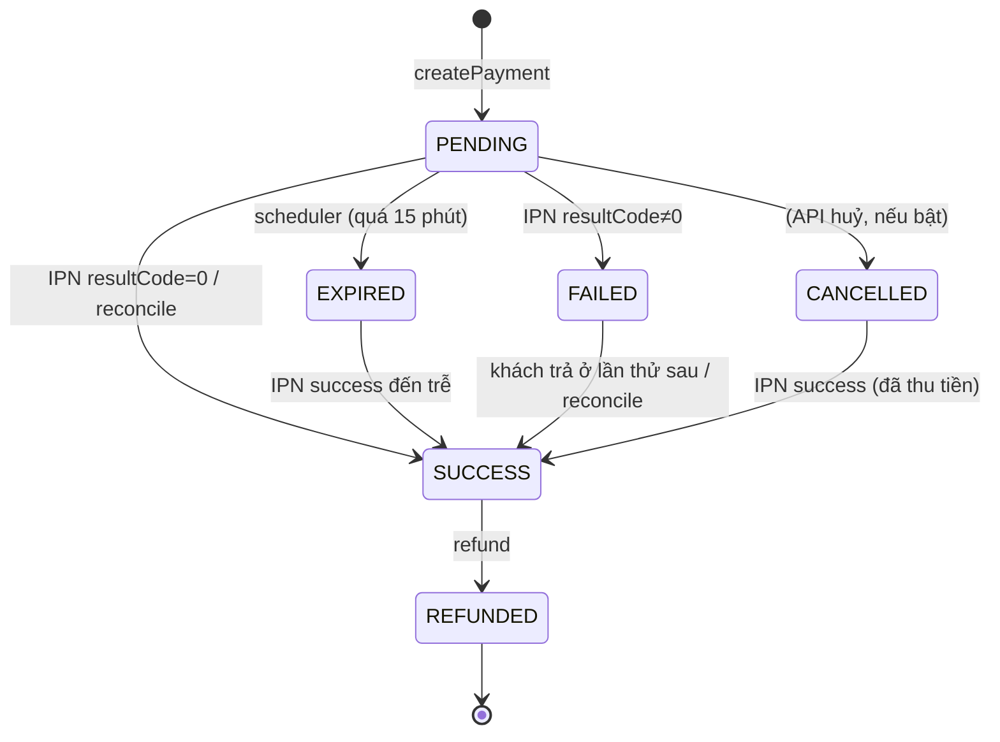

# MoMo Payment Flow — Snapgram

> Tài liệu kiểm tra code + sơ đồ luồng tích hợp **MoMo Payment API v2** trong `payment-service`,
> kèm nhánh Kafka `payment.completed` → `auth-service` cấp Blue Tick.
> Cập nhật: 2026-10-21. Code tham chiếu: `payment-service`, `auth-service`, `infra`.
> Báo cáo tổng hợp service + hạn chế: [`PAYMENT_SERVICE_REPORT.md`](./PAYMENT_SERVICE_REPORT.md).

---

## 0. TL;DR

- **3 endpoint** MoMo: `POST /momo/create`, `POST /momo/ipn`, `GET /momo/return`; thêm `POST /api/admin/payments/{orderId}/reconcile` dùng chung cho VNPay/MoMo.
- **Chỉ IPN (và reconcile) được đổi trạng thái đơn**. Return URL chỉ verify chữ ký rồi 302 về frontend.
- **Auto-reconcile** chạy mỗi 60 giây cho đơn MoMo `PENDING` quá 30 giây hoặc `EXPIRED` trong 15 phút gần nhất.
- Ký **HMAC-SHA256**, raw string theo **thứ tự field cố định của MoMo** (khác VNPay: sort alphabet).
- MoMo `resultCode = 0` được **chuẩn hóa thành `"00"`** để dùng chung `isSuccessCode()` với VNPay.
- Đơn SUCCESS → ghi **outbox** cùng transaction (`eventId` stable) → dispatcher publish `payment.completed` có retry → auth-service cộng `verified_until = GREATEST(now, verified_until) + 30d`.
- **Cảnh báo sandbox:** public test partner `MOMOLRJZ20181206` không gửi IPN cho `payWithATM`; E2E hiện dùng auto-reconcile. Muốn IPN thật phải có partner M4B và đăng ký IPN URL.

---

## 1. Thành phần & file

| Thành phần | File | Vai trò |
|---|---|---|
| Endpoint tạo thanh toán | `payment-service/.../controller/PaymentController.java:35` | `POST /api/payments/momo/create` |
| Callback controller | `payment-service/.../controller/MomoCallbackController.java:32` | `POST /momo/ipn`, `GET /momo/return` |
| Nghiệp vụ | `payment-service/.../service/PaymentService.java:85` | `handleIpn` / `previewReturn` / `reconcile` / `markSuccess` |
| Chọn gateway | `payment-service/.../port/PaymentGatewayRegistry.java` | map `provider → PaymentGateway` |
| Adapter MoMo | `payment-service/.../adapter/momo/MomoPaymentGateway.java:63` | create / verifyCallback / query / ipnAck |
| Ký HMAC | `payment-service/.../adapter/momo/MomoSigner.java:31` | `createRaw`, `queryRaw`, `callbackRaw` |
| Query đối chiếu | `payment-service/.../adapter/momo/MomoQueryClient.java:38` | `POST /v2/gateway/api/query` |
| Cấu hình | `payment-service/.../adapter/momo/MomoProperties.java:12` | `momo.*` (env `MOMO_*`) |
| Kafka publisher | `payment-service/.../adapter/kafka/KafkaPaymentEventPublisher.java` | gửi `payment.completed` (trả future để biết ACK/lỗi) |
| Outbox | `payment-service/.../service/PaymentOutboxDispatcher.java` + `PaymentOutboxStateService.java` | gửi lại event khi Kafka lỗi (lease + backoff) |
| Outbox entity | `payment-service/.../entity/PaymentOutbox.java` + `db/migration/V3__add_payment_outbox.sql` | 1 dòng / đơn, ghi cùng transaction với order |
| Auto-reconcile | `payment-service/.../config/PaymentReconcileScheduler.java` + `PaymentReconcileProperties.java` | query MoMo định kỳ cho đơn chưa có IPN |
| Báo cáo service | `docs/services/payment/PAYMENT_SERVICE_REPORT.md` | tổng hợp kiến trúc, E2E, hạn chế |
| Consumer cấp quyền | `auth-service/.../service/PaymentCompletedConsumer.java:35` | listener `payment.completed` |
| Gateway public path | `api-gateway/.../filter/JwtAuthenticationFilter.java:62` | IPN/return không cần JWT |
| Hạ tầng topic | `infra/create-topics.sh:31` | `payment.completed` + `.DLT` (auto-create = false) |

---

## 2. Kiến trúc tổng quan



---

## 3. Luồng 1 — Tạo thanh toán



**Điểm đáng chú ý**

- `amount` là **Long VND** (không ×100 như VNPay).
- `extraData` lấy từ `momo.extra-data` (mặc định rỗng).
- `requestId = orderId` (duy nhất theo đơn).
- Nếu thiếu key → `IllegalStateException("MoMo is not configured ...")` → 400 ngay, không gọi API.
- Exception từ MoMo → rollback transaction → **không lưu đơn rác**.

---

## 4. Luồng 2 — IPN (server-to-server, nguồn cập nhật trạng thái chính)



**Cây quyết định**



**Bảng ack trả cho MoMo** (`MomoPaymentGateway.ipnAck`)

| Outcome | resultCode | message | MoMo sẽ |
|---|---|---|---|
| `HANDLED`, `ALREADY_CONFIRMED` | `0` | `Confirm Success` | dừng retry |
| `ORDER_NOT_FOUND`, `INVALID_SIGNATURE` | `9` | tên outcome | retry theo lịch của MoMo |
| `INVALID_AMOUNT` | `22` | `Invalid amount` | retry / báo lỗi |

**Idempotency**

- `payment_event_log.event_id` UNIQUE, dạng `momo:{orderId}:{transId}` (reconcile dùng cùng format); chèn bằng `INSERT ... ON CONFLICT DO NOTHING` nên không làm hỏng transaction khi trùng.
- `payment_outbox.order_id` UNIQUE — mỗi đơn tối đa 1 event `payment.completed`.
- Đơn đã SUCCESS → `ALREADY_CONFIRMED` → ack `0` để MoMo không retry.
- Đơn `EXPIRED`/`FAILED` mà IPN báo thành công → vẫn `markSuccess` (khách đã trả tiền), log WARN để đối soát.
- IPN gửi lặp (MoMo retry) an toàn: lần 2 rơi vào nhánh "status == SUCCESS".

---

## 5. Luồng 3 — Return URL (trình duyệt)



- Return URL **không** được dùng để chốt đơn (tránh giả mạo/kẻ gian đổi trạng thái bằng query string).
- `signatureValid=false` vẫn redirect nhưng frontend phải hiển thị cảnh báo.

---

## 6. Luồng 4 — Query / Reconcile (admin + auto)



**Map `resultCode` của query → `QueryResult`** (đã kiểm chứng sandbox 2026-10-17)

| resultCode | Ý nghĩa thực tế | found | success |
|---|---|---|---|
| `0` | Đã thanh toán thành công | ✅ | ✅ |
| `1000` | Đơn đã tạo, chờ khách xác nhận | ✅ | ❌ |
| `1005` | Không tồn tại / hết hạn | ❌ | ❌ |
| `9` | Lỗi chung | chỉ khi `transId > 0` | ❌ |

> ⚠️ Đây là bug đã sửa: trước 2026-10-17 code coi `found = resultCode==0 || transId>0`
> nên đơn pending (`1000`, `transId=0`) bị trả **404 "không tồn tại"**; nay `1000` → found.

### 6.1. Auto-reconcile scheduler

`PaymentReconcileScheduler` chạy sau khi service khởi động 30 giây, sau đó lặp mỗi 60 giây:

1. Tìm tối đa 20 đơn `provider = MOMO`:
   - `PENDING` có `created_at < now - 30s`;
   - hoặc `EXPIRED` có `expired_at > now - 15 phút`.
2. Gọi `PaymentService.reconcile(orderId)` cho từng đơn.
3. Đơn nào provider báo chưa thành công/sai amount → bỏ qua, lượt sau thử lại.
4. Đơn thành công → `markSuccess` như reconcile thủ công (event log + outbox cùng transaction).

Cấu hình trong `application.yml`:

| Biến | Mặc định | Ý nghĩa |
|---|---|---|
| `PAYMENT_RECONCILE_ENABLED` | `true` | Bật/tắt scheduler |
| `PAYMENT_RECONCILE_PROVIDER` | `MOMO` | Provider được quét |
| `PAYMENT_RECONCILE_INTERVAL_MS` | `60000` | Chu kỳ quét |
| `PAYMENT_RECONCILE_INITIAL_DELAY_MS` | `30000` | Chờ trước lượt đầu |
| `PAYMENT_RECONCILE_MIN_AGE_SECONDS` | `30` | Bỏ qua đơn quá mới |
| `PAYMENT_RECONCILE_EXPIRED_GRACE_SECONDS` | `900` | Vẫn quét đơn EXPIRED trong 15 phút |
| `PAYMENT_RECONCILE_BATCH_SIZE` | `20` | Số đơn mỗi lượt |

Log thành công:

```text
Auto-reconciled MOMO order <orderId> -> SUCCESS
Auto-reconcile MOMO: 1 order(s) marked SUCCESS
```

Đã kiểm chứng thật: đơn `b63a9ca446a84689b012b9f8fe95e386` được scheduler chốt lúc
`2026-10-21 09:53:05Z`, outbox `SENT`, auth nhận event và cấp Blue Tick đến `2027-01-18`.

> Đây là **fallback**, không phải IPN. Đơn EXPIRED quá 15 phút sẽ không còn trong batch;
> khi đó dùng admin reconcile. Xem thêm hạn chế tại `PAYMENT_SERVICE_REPORT.md`.

---

## 7. Luồng 5 — `payment.completed` → Blue Tick



**Payload `payment.completed`**

```json
{
  "eventId": "momo:<orderId>:<transId>",
  "paymentId": "uuid",
  "orderId": "32-hex",
  "userId": "uuid",
  "productCode": "BLUE_TICK",
  "amount": 199000,
  "currency": "VND",
  "provider": "MOMO",
  "transactionId": "4088878653",
  "occurredAt": "2026-10-19T12:34:56Z"
}
```

**Cấu hình outbox** (`payment.outbox.*`, có mặc định trong code)

| Biến | Mặc định | Ý nghĩa |
|---|---|---|
| `PAYMENT_OUTBOX_POLL_INTERVAL_MS` | 2000 | chu kỳ quét outbox |
| `PAYMENT_OUTBOX_BATCH_SIZE` | 50 | số event mỗi lượt gửi |
| `PAYMENT_OUTBOX_LEASE_SECONDS` | 60 | lease chống 2 instance gửi trùng |
| `PAYMENT_OUTBOX_MAX_ATTEMPTS` | 10 | quá số lần → `FAILED` |
| `PAYMENT_OUTBOX_SEND_TIMEOUT_SECONDS` | 10 | chờ broker ACK trước khi coi là lỗi |

---

## 8. State machine của `payment_orders.status`



> `EXPIRED/FAILED/CANCELLED → SUCCESS` được phép vì IPN success đã qua verify chữ ký + đối chiếu amount:
> provider xác nhận **đã thu tiền** thì bắt buộc phải cấp quyền, dù local từng đánh dấu hết hạn/thất bại.
> `REFUNDED` là trạng thái cuối, không quay lại `SUCCESS`.

---

## 9. Quy tắc chữ ký (quan trọng nhất)

`signature = HMAC_SHA256(secretKey, raw).hex()` — **không URL-encode**, **không sort**, nối bằng `&` theo đúng thứ tự dưới đây.

| Request | Raw string (đúng thứ tự) |
|---|---|
| Create | `accessKey=&amount=&extraData=&ipnUrl=&orderId=&orderInfo=&partnerCode=&redirectUrl=&requestId=&requestType=` |
| Query | `accessKey=&orderId=&partnerCode=&requestId=` |
| IPN & Return | `accessKey=&amount=&extraData=&message=&orderId=&orderInfo=&orderType=&partnerCode=&payType=&requestId=&responseTime=&resultCode=&transId=` |

- Field thiếu → chuỗi rỗng (không bỏ field).
- So sánh chữ ký bằng `MessageDigest.isEqual` (constant-time).
- IPN: kiểm tra `partnerCode` **trước** khi verify chữ ký để chặn callback merchant khác.

---

## 10. Cấu hình

| Biến | Bắt buộc | Mặc định | Ghi chú |
|---|---|---|---|
| `MOMO_PARTNER_CODE` | ✅ | — | sandbox: `MOMOLRJZ20181206` |
| `MOMO_ACCESS_KEY` | ✅ | — | |
| `MOMO_SECRET_KEY` | ✅ | — | |
| `MOMO_BASE_URL` | ❌ | `https://test-payment.momo.vn` | prod: `https://payment.momo.vn` |
| `MOMO_RETURN_URL` | ⚠️ | `http://localhost:8080/api/payments/momo/return` | browser redirect được, không cần public |
| `MOMO_IPN_URL` | ⚠️ | `http://localhost:8080/api/payments/momo/ipn` | **phải public** (tunnel/domain) thì MoMo mới gọi được |
| `MOMO_REQUEST_TYPE` | ❌ | `captureWallet` | |
| `MOMO_LANG` | ❌ | `vi` | |
| `MOMO_TIMEOUT_SECONDS` | ❌ | `30` | MoMo yêu cầu ≥30s |

Thiếu 3 key bắt buộc → `POST /momo/create` trả 400 với message rõ ràng; startup log cảnh báo
(`PaymentGatewayStartupLogger`).

---

## 11. Kết quả kiểm tra code (review)

### ✅ Điểm tốt

1. Chữ ký bám **đúng thứ tự field** trong docs MoMo, có test vector chính thức + test live sandbox.
2. `verifyCallback` chặn `partnerCode` lạ trước khi verify → tránh callback của merchant khác.
3. Guard đầy đủ: order không tồn tại / sai amount / order đã SUCCESS.
4. Pessimistic lock `findByOrderIdForUpdate` chống 2 IPN đồng thời.
5. Idempotency 2 lớp: `payment_event_log` (payment-service) + `auth_payment_processed_events` (auth-service), chèn bằng `ON CONFLICT DO NOTHING`.
6. Chuẩn hóa `resultCode 0 → "00"` giúp dùng chung code success với VNPay.
7. Return URL không đổi DB — đúng nguyên tắc "chỉ tin IPN".
8. Outbox `payment_outbox` đảm bảo event `payment.completed` không mất khi Kafka lỗi.
9. DLT `payment.completed.DLT` cho consumer auth-service (retry 3 lần rồi đẩy DLT).
10. Timeout đọc ≥30s theo yêu cầu MoMo; create lỗi → rollback không lưu đơn rác.

### ✅ Đã sửa sau review (2026-10-19)

| # | Vấn đề cũ | Cách sửa | File |
|---|---|---|---|
| 1 | Đơn `EXPIRED`/`FAILED` mà khách vẫn trả tiền bị coi là `ALREADY_CONFIRMED` → không cấp quyền | State machine cho phép `EXPIRED/FAILED/CANCELLED → SUCCESS`; IPN success luôn `markSuccess` + log WARN | `PaymentStateMachine.java:21`, `PaymentService.java:107` |
| 2 | Publish Kafka fire-and-forget, lỗi chỉ log → mất event dù đã ghi event log | Transactional outbox: ghi `payment_outbox` cùng transaction, dispatcher gửi lại có lease + backoff, quá `max-attempts` → `FAILED` (còn row đối soát) | `db/migration/V3__add_payment_outbox.sql`, `PaymentOutboxDispatcher.java`, `PaymentOutboxStateService.java` |
| 3 | Bắt exception từ `saveAndFlush` trong `@Transactional` → session rollback-only | `INSERT ... ON CONFLICT (event_id) DO NOTHING`, trả update count (0 = đã xử lý) | `PaymentEventLogRepository.java:19` |

### ⚠️ Còn lại

| # | Vấn đề | Vị trí | Ảnh hưởng | Đề xuất |
|---|---|---|---|---|
| 1 | `baseUrl` không trim dấu `/` cuối | `MomoProperties.java:15` | Nếu env có `/` → URL `//v2/gateway/api/create` | Trim khi build URL |
| 2 | Ack `9` cho `INVALID_SIGNATURE` khiến MoMo retry vô ích | `MomoPaymentGateway.java:192` | Retry thừa (không sai dữ liệu) | Giữ theo docs, hoặc ack `0` + log alert nếu chấp nhận bỏ |
| 3 | Không có rate limit cho endpoint IPN public | `MomoCallbackController.java:32` | Bị spam request | Rate limit ở gateway hoặc bucket4j |
| 4 | Return URL không đối chiếu amount với DB | `MomoCallbackController.java:43` | Chỉ ảnh hưởng hiển thị (không đổi DB) | Frontend luôn lấy trạng thái từ `GET /api/payments/{orderId}` |
| 5 | Outbox `FAILED` chưa có alert/đối soát tự động | `PaymentOutboxStateService.java:51` | Event kẹt cần người xử lý | Thêm metric/alert hoặc job cảnh báo row `FAILED` |
| 6 | Public test partner không gửi IPN cho `payWithATM` | MoMo sandbox / partner config | Không test được IPN thật; phải dùng auto-reconcile | Đăng ký M4B, cấu hình IPN URL; test lại `captureWallet` trước |
| 7 | Auto-reconcile là polling, batch 20, mỗi 60s | `PaymentReconcileScheduler.java` | Chậm tối đa ~60s; backlog lớn bị trễ; EXPIRED quá 15 phút bị bỏ sót | Thêm metric/alert, tăng batch có kiểm soát, admin reconcile cho đơn cũ |
| 8 | `AtomicBoolean` chỉ chống overlap trong 1 JVM | `PaymentReconcileScheduler.java:35` | Nhiều instance có thể query trùng provider (DB vẫn idempotent) | Dùng ShedLock / DB advisory lock nếu chạy multi-instance |

---

## 12. Kiểm thử

| Loại | File | Trạng thái |
|---|---|---|
| Unit — chữ ký theo vector docs | `payment-service/src/test/.../MomoPaymentUnitTest.java` | 8 test |
| Unit — luồng service/IPN | `payment-service/src/test/.../PaymentUnitTest.java` | 11 test |
| Unit — outbox dispatcher | `payment-service/src/test/.../PaymentOutboxDispatcherTest.java` | 2 test |
| Unit — auto-reconcile scheduler | `payment-service/src/test/.../PaymentReconcileSchedulerTest.java` | 3 test |
| Unit — VNPay | `payment-service/src/test/.../VnpayPaymentUnitTest.java` | 16 test |
| Live sandbox (env-gated) | `payment-service/src/test/.../MomoSandboxLiveTest.java` | 4 test, skip mặc định nếu thiếu env |
| Unit — consumer Blue Tick | `auth-service/src/test/.../PaymentCompletedConsumerTest.java` | 6 test |

Tổng `payment-service`: **44 test, 0 fail, 4 skip** (số liệu 2026-10-21).

Chạy toàn bộ unit test:

```bash
mvn -pl payment-service test
```

Chạy live (key nằm trong `.env`):

```bash
set -a && . ./.env && set +a
mvn -o -pl payment-service test -Dtest=MomoSandboxLiveTest
```

Kết quả sandbox thật đã xác minh (2026-10-17):

- create → `resultCode 0`, trả `payUrl` thật.
- query đơn pending → `resultCode 1000`, `transId 0`, amount khớp.
- query orderId lạ → `resultCode 1005`.

**Muốn user bấm trả tiền thật → xem mục 13 (Test UAT).** IPN thật còn phụ thuộc partner.

---

## 13. Test UAT với MoMo (app test / ATM simulator)

> Nguồn: [MoMo Test Instructions](https://developers.momo.vn/v3/docs/payment/onboarding/test-instructions/) + [trang tải MoMo Test App](https://developers.momo.vn/v3/download).
> Điều kiện **bắt buộc** cho mọi cách: `MOMO_IPN_URL` phải là URL public (MoMo gọi server-to-server, không gọi được localhost).

### 13.0. Ba mức test — đừng nhầm IPN thật với fallback

| Mức | Cách làm | Kết quả mong đợi |
|---|---|---|
| A. Public partner + ATM | Dùng `MOMOLRJZ20181206`, `MOMO_REQUEST_TYPE=payWithATM` | Thanh toán được; **có thể không có IPN**; đơn được auto-reconcile chốt sau ~30-90s |
| B. Public partner + webhook.site | Tạo đơn probe trỏ `ipnUrl` sang webhook.site | Nếu webhook.site **0 request** → MoMo không gửi IPN; không phải lỗi tunnel/code |
| C. Partner M4B + IPN thật | Đăng ký M4B, cấu hình IPN URL public, dùng credential riêng | IPN POST JSON tới server; đây là E2E IPN thật |

> Kết quả đã kiểm chứng 2026-10-21: mức A/B **không nhận được IPN** với public partner.
> Muốn đạt mức C phải đăng ký M4B và đăng ký IPN URL; xem `PAYMENT_SERVICE_REPORT.md` mục 8.1.

### 13.1. Cách A — MoMo Test App (đúng luồng `captureWallet`)

| Bước | Chi tiết |
|---|---|
| 1. Tải app | https://developers.momo.vn/v3/download (Android APK / iOS). **Gỡ app MoMo thật trước** khi cài app test |
| 2. iOS | Settings → General → VPN & Device Management → Trust "ONLINE MOBILE SERVICE JSC" (MoMo Test) |
| 3. Tạo ví test | SĐT random 10 số hợp lệ VN (đúng prefix nhà mạng) → **OTP `000000`**, **password `000000`** |
| 4. Nạp tiền | Liên kết thẻ ATM Agribank dạng `9704 05XX XXXX XXXX` (16 số, X = 0-9) → Home → Topup |
| 5. Thanh toán | Mở `payUrl` (hoặc quét QR) bằng app test → ví test trả tiền |

Lưu ý: 24h đầu ví mới có thể bị hạn chế (kill app mở lại / chờ). eKYC thì liên hệ MoMo.

### 13.2. Cách B — ATM simulator (không cần app, nhanh nhất để test server)

1. Đổi `MOMO_REQUEST_TYPE=payWithATM` trong `.env` → restart payment-service (**không cần sửa code**; IPN ATM vẫn ký bằng đúng bộ field nên `verifyCallback` không đổi).
2. Mở `payUrl` → trang NAPAS/bank giả lập → dùng thẻ test dưới đây.
3. **OTP đúng là literal `otp`** (chữ thường, đúng 3 ký tự). Không dùng `123456`/`000000` cho trang ATM.
   Đã xác minh thành công ngày 2026-10-21.

| # | Tên | Số thẻ | Exp | Case |
|---|---|---|---|---|
| 1 | NGUYEN VAN A | `9704 0000 0000 0018` | `03/07` | Thành công |
| 2 | NGUYEN VAN A | `9704 0000 0000 0026` | `03/07` | Thẻ bị khoá |
| 3 | NGUYEN VAN A | `9704 0000 0000 0034` | `03/07` | Không đủ số dư |
| 4 | NGUYEN VAN A | `9704 0000 0000 0042` | `03/07` | Quá hạn mức |

→ Thẻ 2-4 dùng để test nhánh IPN `resultCode≠0` → đơn `FAILED` **nếu partner có gửi IPN**.
Với public partner hiện tại, các case lỗi này chưa được kiểm chứng live; đừng suy ra IPN đã chạy
chỉ vì trang báo lỗi.

### 13.3. Dựng hạ tầng + chạy

```bash
# 1. Tunnel public cho IPN (máy dev chưa cài sẵn cloudflared)
curl -L -o /tmp/cloudflared https://github.com/cloudflare/cloudflared/releases/latest/download/cloudflared-linux-amd64
chmod +x /tmp/cloudflared && /tmp/cloudflared tunnel --url http://localhost:8080
# → lấy URL https://xxxx.trycloudflare.com, gán MOMO_IPN_URL=<url>/api/payments/momo/ipn trong .env
# (gateway đã whitelist /api/payments/momo/ipn — JwtAuthenticationFilter.java:62, không cần JWT)

# 2. Hạ tầng + services
docker compose -f infra/docker-compose.yml up -d   # postgres-payment, postgres-auth, kafka, redis
set -a && . ./.env && set +a
mvn -pl payment-service spring-boot:run            # + auth-service, api-gateway
# chạy nền: nohup mvn -pl payment-service spring-boot:run > /tmp/payment-service.log 2>&1 &

# 3. Kiểm tra service sống
curl -fsS http://localhost:8087/actuator/health

# 4. Tạo đơn (JWT của user thật) rồi mở payUrl trả về
curl -sX POST http://localhost:8080/api/payments/momo/create \
  -H "Authorization: Bearer <access_token>" -H 'Content-Type: application/json' \
  -d '{"productCode":"BLUE_TICK"}'
```

Auto-reconcile bật mặc định (`PAYMENT_RECONCILE_ENABLED=true`). Sau khi service start, chờ
khoảng 30 giây để scheduler chạy lượt đầu; nếu tắt, đơn sẽ chỉ được chốt bằng IPN hoặc
admin reconcile.

### 13.4. Sau khi trả tiền — kiểm tra gì

| Lớp | Kiểm tra |
|---|---|
| Log payment-service | Có `MOMO IPN ...`/`markSuccess` **hoặc** `Auto-reconciled MOMO order ... -> SUCCESS` |
| `payment_orders` | `status = SUCCESS`, `provider_response_code = 00`, có `provider_transaction_no` |
| `payment_event_log` | 1 row/event `momo:{orderId}:{transId}` (idempotent) |
| `payment_outbox` | `status = SENT` (nếu còn `PENDING`/`FAILED` → xem log dispatcher) |
| Kafka | topic `payment.completed` có message key = orderId, `provider = MOMO` |
| auth-service | `auth_payment_processed_events` 1 row; `auth_users.verified_until` +30d |

**Kết quả đã kiểm chứng thật (2026-10-21):**

| Order | transId | Cách chốt | Kết quả |
|---|---|---|---|
| `6293a0eedef5412cb6e11efecac347f1` | `4869805067` | Admin reconcile | SUCCESS; outbox SENT; auth đến `2026-12-19` |
| `b63a9ca446a84689b012b9f8fe95e386` | `4869840793` | Auto-reconcile lúc `09:53:05Z` | SUCCESS; outbox SENT; auth đến `2027-01-18` |

**Nếu IPN không về:**

1. Chờ 30-90 giây, xem log scheduler; nếu thấy `Auto-reconciled ... -> SUCCESS` thì fallback đã chạy.
2. Nếu quá 15 phút sau expiry, gọi admin:
   `POST /api/admin/payments/{orderId}/reconcile` (JWT admin).
3. Nếu vẫn không có IPN, tạo đơn probe trỏ `ipnUrl` sang `webhook.site`; nếu webhook.site cũng
   0 request thì lỗi nằm phía partner, không phải tunnel/signature.
4. Với public partner `MOMOLRJZ20181206`, không có IPN là hành vi đã gặp; muốn IPN thật cần M4B.

---

## 14. Checklist chạy thật

1. Điền `MOMO_PARTNER_CODE` / `MOMO_ACCESS_KEY` / `MOMO_SECRET_KEY` vào `.env`.
2. `MOMO_IPN_URL` phải là **URL public** (Cloudflare tunnel / domain). Quick tunnel đổi URL mỗi lần chạy → nhớ cập nhật `.env`.
3. Chạy migration `V2__rename_payment_provider_columns.sql` + `V3__add_payment_outbox.sql` (bảng `payment_outbox`).
4. Topic `payment.completed` + `payment.completed.DLT` phải tồn tại (auto-create đang **tắt** — `infra/create-topics.sh`).
5. `auth-service` cần cấu hình `payment.grants.BLUE_TICK` (mặc định `30d`) và consumer group `auth-service`.
6. Giữ `PAYMENT_RECONCILE_ENABLED=true` (mặc định) và restart payment-service sau khi đổi code/config.
7. Test end-to-end: create → thanh toán ATM/ví MoMo sandbox → chờ scheduler hoặc IPN → kiểm tra
   `payment_event_log`, `payment_outbox`, `auth_payment_processed_events`.
8. Nếu nghiệm thu yêu cầu **IPN thật**: đăng ký M4B, cấu hình IPN URL, dùng partner riêng;
   public partner hiện tại không đáp ứng được.
