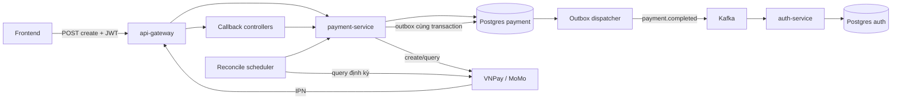
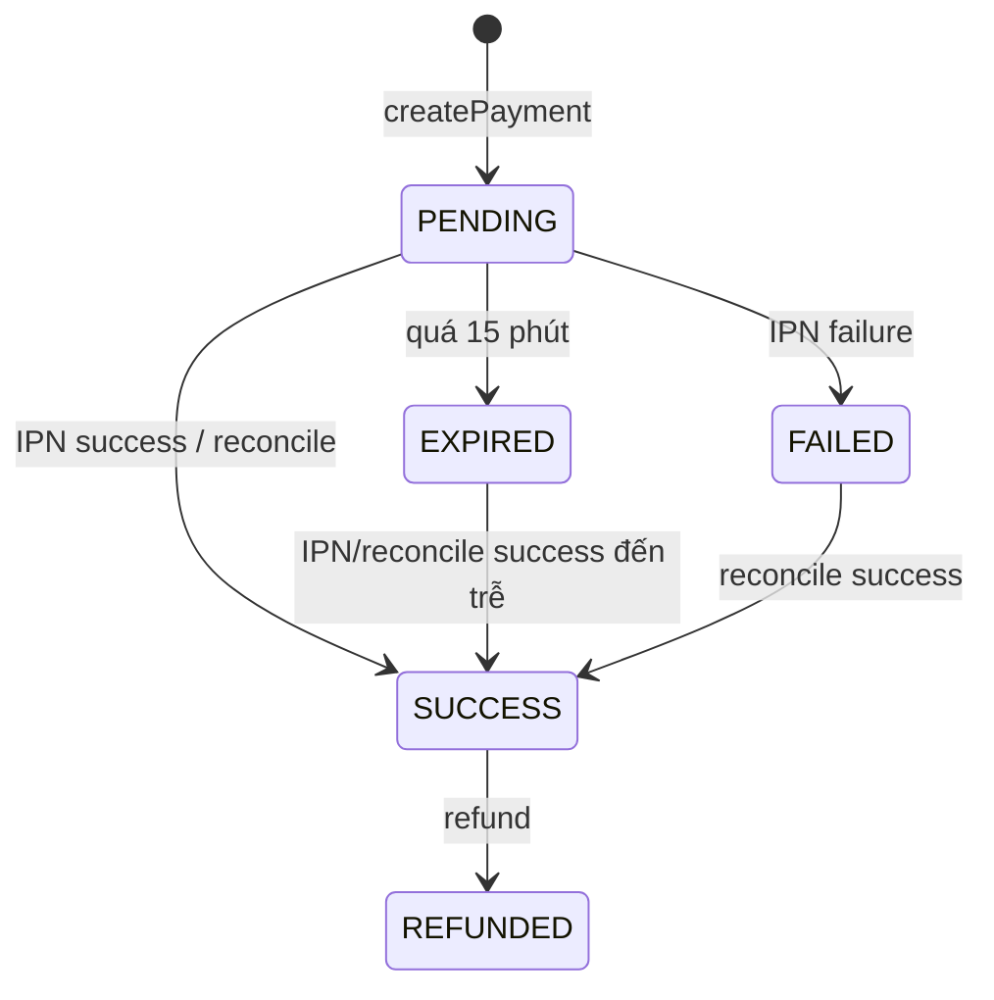

# Báo cáo `payment-service` — Snapgram

> Cập nhật: 2026-10-21. Phạm vi: service thanh toán (`payment-service`) và luồng cấp Blue Tick
> qua Kafka trong `auth-service`. Tài liệu test chi tiết: [`MOMO_PAYMENT_FLOW.md`](./MOMO_PAYMENT_FLOW.md).

---

## 1. Tóm tắt điều hành

`payment-service` xử lý tạo đơn, nhận callback và đối chiếu giao dịch với hai provider:
**VNPay** và **MoMo**. Sau khi đơn thành công, service ghi event vào outbox, publish
`payment.completed` qua Kafka; `auth-service` consume event và cộng hạn Blue Tick.

**Kết quả E2E:**

- VNPay: đã chạy thật end-to-end qua IPN, đơn thành công và Blue Tick được cấp.
- MoMo ATM: thanh toán sandbox thành công; đơn được chốt qua **admin reconcile** và sau đó
  qua **auto-reconcile scheduler**. Outbox, Kafka và cấp Blue Tick đều đã kiểm chứng.
- MoMo IPN thật: **chưa kiểm chứng được** vì public test partner không gửi IPN. Đây là hạn chế
  chính, được phân tích ở mục 8.

**Kết luận ngắn:** luồng nghiệp vụ “khách trả tiền → cấp Blue Tick” đã đạt E2E. Luồng
“MoMo gọi IPN” chưa đạt E2E thật; auto-reconcile hiện là fallback, không thay thế IPN trong
môi trường production.

---

## 2. Phạm vi và thành phần

| Thành phần | Vai trò |
|---|---|
| `PaymentController` | Tạo đơn VNPay/MoMo, xem đơn, danh sách đơn của user |
| `MomoCallbackController` | Nhận IPN và return URL của MoMo |
| `VnpayCallbackController` | Nhận IPN và return URL của VNPay |
| `AdminPaymentController` | Danh sách toàn bộ đơn, reconcile thủ công |
| `PaymentService` | Nghiệp vụ tạo đơn, IPN, return, reconcile, expiry |
| `PaymentReconcileScheduler` | Tự động query MoMo cho đơn PENDING/EXPIRED |
| `PaymentExpiryScheduler` | Chuyển đơn PENDING quá hạn sang EXPIRED |
| `PaymentOutboxDispatcher` | Gửi event `payment.completed` từ outbox, retry khi Kafka lỗi |
| `MomoPaymentGateway` / `VnpayPaymentGateway` | Adapter gọi API và verify chữ ký provider |

---

## 3. Kiến trúc luồng



### Trạng thái đơn



---

## 4. API chính

| Method | Path | Ghi chú |
|---|---|---|
| `POST` | `/api/payments/vnpay/create` | Tạo đơn VNPay |
| `POST` | `/api/payments/momo/create` | Tạo đơn MoMo |
| `GET` | `/api/payments/{orderId}` | Owner hoặc admin |
| `GET` | `/api/payments/me` | Danh sách đơn của user |
| `POST` | `/api/payments/momo/ipn` | Public, verify HMAC; nguồn cập nhật trạng thái |
| `GET` | `/api/payments/momo/return` | Public, chỉ verify rồi redirect frontend |
| `POST` | `/api/payments/vnpay/ipn` | Public, verify chữ ký |
| `GET` | `/api/payments/vnpay/return` | Public, redirect frontend |
| `GET` | `/api/admin/payments` | Admin, filter/sort |
| `POST` | `/api/admin/payments/{orderId}/reconcile` | Admin, query provider và chốt đơn |

Return URL **không đổi trạng thái DB**. Frontend phải poll `GET /api/payments/{orderId}`
để lấy trạng thái thật.

---

## 5. Luồng xử lý chính

### 5.1 Tạo đơn

1. `PaymentService` lấy product/amount từ catalog phía server, không tin amount từ client.
2. Sinh `orderId` UUID hex 32 ký tự, lưu `PENDING`, hết hạn sau 15 phút.
3. Gọi gateway provider để lấy `payUrl`.
4. Trả `201` kèm `orderId`, `paymentUrl`, `status`, `expiresAt`.

### 5.2 IPN

1. Gateway kiểm tra `partnerCode`, verify HMAC constant-time.
2. Khóa đơn bằng `findByOrderIdForUpdate`.
3. Kiểm tra amount, trạng thái, `resultCode`.
4. Nếu thành công: `SUCCESS` + ghi `payment_event_log` + `payment_outbox` trong cùng transaction.
5. Trả ack đúng format provider (`resultCode` cho MoMo, `RspCode` cho VNPay).

### 5.3 Reconcile

- **Admin reconcile**: `POST /api/admin/payments/{orderId}/reconcile`; gọi Query API của provider,
  kiểm tra amount, rồi `markSuccess`.
- **Auto reconcile**: scheduler mỗi 60 giây tìm đơn:
  - `PENDING` đã tạo quá 30 giây;
  - `EXPIRED` trong vòng 15 phút kể từ `expired_at`.
- Mỗi lượt tối đa 20 đơn; gọi `PaymentService.reconcile` cho từng đơn.
- Lỗi từng đơn không chặn các đơn còn lại.

### 5.4 Outbox → Kafka → Blue Tick

- `payment_event_log` chống xử lý trùng event.
- `payment_outbox` giữ event cùng transaction với đơn; dispatcher gửi Kafka, retry backoff.
- `auth-service` consume `payment.completed`, ghi `auth_payment_processed_events` và cộng
  `verified_until` thêm 30 ngày.

---

## 6. Dữ liệu và idempotency

| Bảng | Vai trò |
|---|---|
| `payment_orders` | Đơn hàng, trạng thái, mã giao dịch provider |
| `payment_event_log` | Idempotency callback/reconcile; `event_id` UNIQUE |
| `payment_outbox` | Transactional outbox; `order_id` UNIQUE |
| `auth_payment_processed_events` | Idempotency cấp quyền phía auth |
| `auth_users` | `is_verified`, `verified_until` |

Event ID dùng chung cho IPN và reconcile: `{provider}:{orderId}:{transactionNo}`.
Nhờ vậy IPN đến lặp hoặc reconcile chạy lại không cấp quyền hai lần.

---

## 7. Kết quả E2E đã kiểm chứng

| Luồng | Order / transaction | Kết quả |
|---|---|---|
| VNPay sandbox | `ab85e394c21e45548c59db7f2718e4c5`, transId `15710634` | IPN thật; đơn SUCCESS; Blue Tick được cấp |
| MoMo ATM + admin reconcile | `6293a0eedef5412cb6e11efecac347f1`, transId `4869805067` | SUCCESS; event log + outbox SENT + Kafka + auth đến `2026-12-19` |
| MoMo ATM + auto reconcile | `b63a9ca446a84689b012b9f8fe95e386`, transId `4869840793` | Scheduler tự chốt lúc `09:53:05Z`; outbox SENT; auth đến `2027-01-18` |
| MoMo IPN thật | Đơn probe `ipnprobeq9z8js7g0myuughb` | Không có request nào tới webhook.site; chưa E2E được IPN |

Bằng chứng auto-reconcile:

```text
2026-10-21 09:53:05 - Auto-reconciled MOMO order b63a9ca446a84689b012b9f8fe95e386 -> SUCCESS
2026-10-21 09:53:05 - Auto-reconcile MOMO: 1 order(s) marked SUCCESS
```

---

## 8. Hạn chế còn lại

### 8.1. MoMo public test partner không gửi IPN

- Đã thử cả Cloudflare tunnel và `webhook.site` độc lập; đơn thanh toán thành công nhưng
  **0 request IPN**.
- Endpoint IPN public vẫn sống: POST body rỗng trả HTTP 200
  `{"message":"INVALID_SIGNATURE","resultCode":"9"}`.
- Vì vậy chưa thể chứng minh nhánh xử lý IPN thật với payload do MoMo ký.
- Nguyên nhân nằm phía partner/sandbox: public partner dùng chung, không có merchant portal
  để bật/đăng ký IPN; cũng có thể luồng `payWithATM` không được bật IPN.
- Muốn có IPN thật cần đăng ký **M4B (MoMo for Business)**, lấy partner riêng, cấu hình
  IPN URL public và test lại.

### 8.2. Auto-reconcile chỉ là fallback

- Là polling mỗi 60 giây, không phải event-driven; đơn có thể chậm tối đa khoảng 60 giây.
- Chỉ chạy cho provider cấu hình, mặc định `MOMO`; VNPay không có auto-reconcile.
- Chỉ xử lý tối đa 20 đơn/lượt; backlog lớn sẽ bị trễ.
- Đơn `EXPIRED` quá 15 phút không còn trong batch; phải reconcile thủ công.
- `AtomicBoolean` chỉ chống overlap trong một JVM; nhiều instance có thể cùng query provider
  (dữ liệu vẫn idempotent nhờ DB, nhưng tốn API call).
- Không có metric/alert cho số đơn đã reconcile, backlog hay lỗi provider.

### 8.3. Vận hành và bảo mật

- Endpoint IPN public chưa có rate limit; có thể bị spam.
- IPN sai chữ ký trả ack `9`, MoMo sẽ retry; cần cân nhắc ack `0` + alert nếu muốn tránh retry.
- Outbox `FAILED` chỉ giữ row để đối soát, chưa có alert/job xử lý tự động.
- Return URL không đối chiếu amount với DB; chỉ ảnh hưởng hiển thị, frontend phải lấy trạng thái
  từ API.
- `MOMO_IPN_URL` phải là URL public; quick tunnel đổi URL mỗi lần chạy.
- Secret nằm trong `.env`; production nên dùng secret manager.
- `baseUrl` chưa trim dấu `/` cuối; nếu cấu hình sai có thể tạo URL `//v2/...`.

### 8.4. Kiểm thử

- Unit test hiện có 44 test, trong đó 4 live test bị skip mặc định vì phụ thuộc env.
- Chưa có integration test tự động cho IPN thật, chưa test tải/concurrency.
- Các thẻ ATM lỗi (khóa, không đủ tiền, quá hạn mức) chưa được kiểm chứng live.
- Test guide cũ từng ghi OTP ATM là `123456`; thực tế sandbox dùng literal `otp`.

### 8.5. Phụ thuộc M4B cho production

- Public partner chỉ phù hợp demo/test; không có portal riêng, không cấu hình được IPN.
- Production cần M4B, xác minh doanh nghiệp, chọn payment solution, đăng ký IPN URL và lấy
  credential production.

---

## 9. Đề xuất

1. Đăng ký M4B hoặc xin partner sandbox riêng; cấu hình IPN URL và test lại bằng
   `captureWallet` trước, sau đó `payWithATM`.
2. Thêm metric/alert cho `payment.reconcile`: số đơn xử lý, backlog, lỗi provider, thời gian chạy.
3. Thêm rate limit cho endpoint IPN và cân nhắc ack `0` cho request sai chữ ký.
4. Bổ sung integration test IPN có chữ ký hợp lệ, test idempotency và test multi-instance.
5. Thêm alert cho outbox `FAILED` và job đối soát định kỳ.
6. Với production: dùng secret manager, domain ổn định cho IPN, bật HTTPS và giám sát.

---

## 10. Kết luận

`payment-service` đã hoàn thành luồng nghiệp vụ cốt lõi và chứng minh được E2E đến tận
Blue Tick. Điểm chưa đạt là **IPN thật của MoMo**, do giới hạn của public test partner chứ
không phải lỗi xác thực hay hết hạn mã. Auto-reconcile giúp hệ thống vẫn hoạt động trong
sandbox/demo, nhưng production cần IPN thật từ partner M4B hoặc cơ chế đối soát được giám sát
chặt chẽ.
