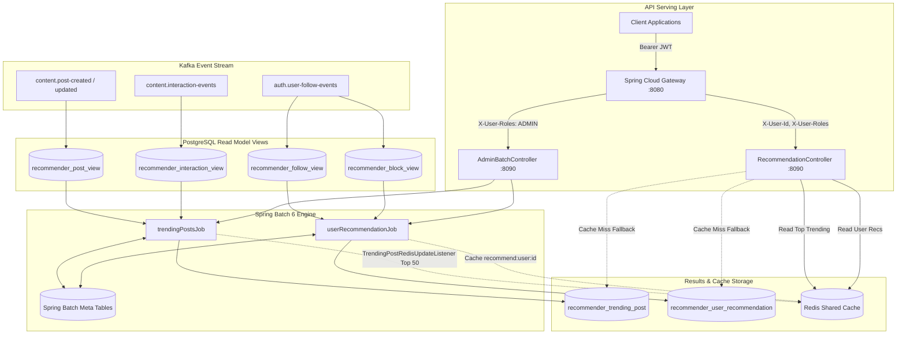

# Kien Truc va Huong Dan Van Hanh Spring Batch (Recommender Service)

Snapgram Server · He thong goi y noi dung va ket noi nguoi dung · Cap nhat 11/2026

---

## 1. Tong quan

He thong mang xa hoi Snapgram phat sinh lien tuc cac luong tuong tac thoi gian thuc (dang bai, like, follow, mute, block). De phuc vu hai bai toan cot loi:
- **Trending Posts**: Tinh toan bang xep hang cac bai viet xu huong duoc quan tam nhat tren toan mang xa hoi dua tren luot thich, thoi luong xem trung binh va he so suy giam thoi gian (time-decay).
- **User Recommendations**: Goi y danh sach ban be tiem nang cho tung nguoi dung dua tren mang luoi ban chung (Friend-of-Friends), loai tru triet de cac quan he da follow hoac bi chan/an.

### Vi sao su dung Spring Batch?
Thay vi tinh toan realtime truc tiep moi khi nguoi dung tai trang (gay qua tai co so du lieu va tang do tre API), he thong ap dung kien truc **Offline Batch Computing** voi Spring Batch 6 vi cac ly do:
1. **Xu ly theo khoi (Chunk-Oriented Processing)**: Doc, xu ly va ghi du lieu theo tung chunk (mac dinh 20 ban ghi), kiem soat bo nho chat che, tranh tinh trang tran bo nho (OOM) khi quy mo du lieu len den hang trieu ban ghi.
2. **Kha nang chong chiu loi (Fault-Tolerant Skip)**: Khi gap ban ghi bi loi hoac khong hop le, he thong tu dong bo qua (Skip) va ghi log canh bao chi tiet thay vi dung toan bo tien trinh.
3. **Co che phuc hoi tu dong (Checkpoint & Restart)**: Luu vet trang thai thuc thi vao metadata schema cua Spring Batch. Neu co su co xay ra o chunk thu N, he thong cho phep khoi dong lai (Restart) va tiep tuc chinh xac tu diem dung, tuyet doi khong doc hay xu ly lai cac chunk da commit thanh cong truoc do.
4. **Ghi theo khoa tat dinh (Idempotent Upsert)**: ID ban ghi dau ra duoc tinh toan co dinh tu ID nguoi dung va ID bai viet, dam bao viec chay lai job nhieu lan khong lam phat sinh du lieu trung lap.

---

## 2. Kien truc tong the va luong du lieu



---

## 3. Dac ta chi tiet cac Batch Jobs

### 3.1 trendingPostsJob (Tinh toan Top bai viet xu huong)
- **Ten Job**: `trendingPostsJob`
- **Ten Step**: `trendingPostsStep`
- **Reader (`RepositoryItemReader<RecommenderPostView>`)**:
  - Truy van tu `recommender_post_view` voi dieu kien `visibility = 'PUBLIC'`.
  - Phim sap xep tat dinh (Deterministic Tie-Breaker): `ORDER BY createdAt DESC, postId ASC`.
  - Kich thuoc trang doc bang `chunkSize` (mac dinh 20).
- **Processor (`TrendingPostProcessor`)**:
  - Stateless: khong duy tri bo nho dem giua cac ban ghi.
  - Tieu chi ban ghi hong (Malformed Post Criteria):
    1. `postId` bi null.
    2. `authorId` bi null.
    3. `createdAt` bi null.
    4. `contentType` bi null, rong hoac khong nam trong tap hop hop le (`POST`, `IMAGE`, `VIDEO`, `CAROUSEL`, `REEL`, `TEXT`, `STORY`).
    Khi gap mot trong cac truong hop tren, nem `MalformedPostException` de `ItemSkipListener` ghi nhan va tiep tuc xu ly cac ban ghi tiep theo.
  - Tinh toan so lieu tuong tac null-safe: luot thich va thoi luong xem trung binh (`avgWatchTime`).
  - Moc thoi gian `calculatedAt` su dung chung gia tri `jobParameters['timestamp']` de dam bao cong thuc suy giam thoi gian (time-decay) dong nhat giua cac chunk va ca khi restart.
- **Writer (`TrendingPostWriter`)**:
  - Ghi vao bang `recommender_trending_post`.
  - Idempotent: Truong `id` duoc gan bang `post.getPostId()`. Khi chay lai, co so du lieu thuc hien cap nhat ban ghi hien co chu khong sinh them dong moi.
- **Listener cap nhat Cache (`TrendingPostRedisUpdateListener`)**:
  - Chay sau khi step hoan tat thanh cong (`COMPLETED`).
  - Truy van Top 50 bai viet co diem so cao nhat tu co so du lieu theo thu tu `score DESC, postId ASC`.
  - Gan xep hang `rank` tu 1 den 50 va cap nhat lai vao DB.
  - Dong bo toan bo danh sach Top 50 vao Redis cache tai khoa `trending:posts` voi TTL 6 gio.

### 3.2 userRecommendationJob (Goi y ket noi ban be)
- **Ten Job**: `userRecommendationJob`
- **Ten Step**: `userRecommendationStep`
- **Reader (`RepositoryItemReader<UUID>`)**:
  - Truy van danh sach duy nhat cac `followerId` tu `recommender_follow_view`.
  - Sap xep: `id.followerId ASC`.
- **Processor (`UserRecommendationProcessor`)**:
  - Loai tru danh sach: chinh nguoi dung do, nhung nguoi da follow, nhung nguoi trong danh sach chan (block) hai chieu, va nhung nguoi bi an (mute).
  - Tinh toan diem dua tren so luong ban chung (Friend-of-Friends) theo cong thuc: `score = min(1.0, 0.5 + 0.1 * mutualCount)`.
  - Gioi han toi da 10 ung vien phu hop nhat cho moi nguoi dung.
  - Idempotent: Truong `id` duoc tao tat dinh qua `UUID.nameUUIDFromBytes((userId + ":" + candidateId).getBytes())`.
- **Writer (`UserRecommendationWriter`)**:
  - Ghi danh sach goi y vao bang `recommender_user_recommendation`.
  - Luu danh sach vao Redis cache tai khoa `recommend:user:{userId}` voi TTL 24 gio.

---

## 4. Bang thong so cau hinh (Configuration Properties)

Toan bo cau hinh Spring Batch duoc quan ly tap trung tai lop `BatchProperties` (`@ConfigurationProperties(prefix = "recommender.batch")`):

| Thuoc tinh | Bien moi truong | Gia tri mac dinh | Mo ta |
|---|---|---|---|
| `recommender.batch.chunk-size` | `RECOMMENDER_BATCH_CHUNK_SIZE` | `20` | So luong ban ghi duoc doc va commit trong moi chunk |
| `recommender.batch.trending-cron` | `RECOMMENDER_TRENDING_CRON` | `0 0 */2 * * *` | Bieu thuc Cron chay job trending posts (mac dinh moi 2 gio) |
| `recommender.batch.user-rec-cron` | `RECOMMENDER_USER_REC_CRON` | `0 0 3 * * *` | Bieu thuc Cron chay job goi y ban be (mac dinh 3 gio sang moi ngay) |
| `recommender.batch.scheduled-enabled` | `RECOMMENDER_BATCH_SCHEDULED_ENABLED` | `false` | Bat/tat tu dong kich hoat job theo lich trinh Cron |
| `recommender.batch.skip-limit` | `RECOMMENDER_BATCH_SKIP_LIMIT` | `100` | So luong ban ghi hong toi da duoc phep bo qua truoc khi step bi fail |

---

## 5. Tham chieu API qua API Gateway

Moi thao tac goi vao `recommender-service` bat buoc phai thuc hien thong qua **API Gateway** (`http://localhost:8080`). Cong noi bo `8090` duoc dong hoan toan khoi mang ngoai vi ly do an toan.

### 5.1 Xac thuc & Phan quyen
- Header bat buoc: `Authorization: Bearer <JWT_ACCESS_TOKEN>`
- Gateway kiem tra tinh hop le cua token voi `auth-service`, xoa sach moi header gia mao `X-User-*` tu client, va chen header duoc xac thuc truoc khi forward noi bo.
- Cac API quan tri yeu cau tai khoan phai so huu vai tro `ADMIN`. Neu khong, he thong tra ve `HTTP 403 Forbidden`.

### 5.2 Danh sach cac Endpoint

#### Kich hoat Job thu cong
- **Method**: `POST`
- **URL**: `http://localhost:8080/api/admin/batch/jobs/{jobName}/run`
- **Quyen**: `ADMIN`
- **Response 200 OK**:
  ```json
  {
    "jobExecutionId": 105,
    "jobName": "trendingPostsJob",
    "status": "STARTED",
    "exitCode": "UNKNOWN",
    "exitDescription": "",
    "createTime": "2026-11-06T12:00:00",
    "startTime": "2026-11-06T12:00:00",
    "endTime": null,
    "durationMs": 0,
    "steps": []
  }
  ```

#### Xem chi tiet Execution
- **Method**: `GET`
- **URL**: `http://localhost:8080/api/admin/batch/executions/{id}`
- **Quyen**: `ADMIN`
- **Response 200 OK**:
  ```json
  {
    "jobExecutionId": 105,
    "jobName": "trendingPostsJob",
    "status": "COMPLETED",
    "exitCode": "COMPLETED",
    "exitDescription": "",
    "createTime": "2026-11-06T12:00:00",
    "startTime": "2026-11-06T12:00:00",
    "endTime": "2026-11-06T12:00:08",
    "durationMs": 8250,
    "steps": [
      {
        "stepName": "trendingPostsStep",
        "status": "COMPLETED",
        "exitCode": "COMPLETED",
        "readCount": 5000,
        "writeCount": 4998,
        "commitCount": 250,
        "rollbackCount": 0,
        "readSkipCount": 0,
        "processSkipCount": 2,
        "writeSkipCount": 0,
        "totalSkipCount": 2
      }
    ]
  }
  ```

#### Xem lich su cac lan chay
- **Method**: `GET`
- **URL**: `http://localhost:8080/api/admin/batch/executions?limit=10`
- **Quyen**: `ADMIN`

#### Khoi dong lai Job bi FAILED (Restart)
- **Method**: `POST`
- **URL**: `http://localhost:8080/api/admin/batch/executions/{id}/restart`
- **Quyen**: `ADMIN`
- **Response 200 OK**: Tra ve `JobExecutionResponse` voi ID moi tiep tuc xu ly tu vi tri da dung.

#### Lay danh sach bai viet Trending (User API)
- **Method**: `GET`
- **URL**: `http://localhost:8080/api/recommendations/trending`
- **Quyen**: `USER` hoac `ADMIN`

#### Lay danh sach goi y ban be (User API)
- **Method**: `GET`
- **URL**: `http://localhost:8080/api/recommendations/users`
- **Quyen**: `USER` hoac `ADMIN`

### 5.3 Bang ma loi chuan hoa
| Ma HTTP | Ma loi he thong | Tinh huong |
|---|---|---|
| **400 Bad Request** | `BAD_REQUEST` | ID khong phai so nguyen, job execution khong o trang thai FAILED khi yeu cau restart |
| **401 Unauthorized** | `UNAUTHORIZED` | Thieu hoac sai Bearer JWT token |
| **403 Forbidden** | `FORBIDDEN` | Tai khoan khong so huu quyen `ADMIN` khi goi cac endpoint `/api/admin/batch/**` |
| **404 Not Found** | `NOT_FOUND` | Khong tim thay `jobName` hoac `executionId` |
| **409 Conflict** | `JOB_CONFLICT` | Job dang co mot tien trinh khac chay song song; hoac JobInstance da hoan tat thanh cong truoc do |
| **500 Internal Error** | `INTERNAL_SERVER_ERROR` | Su co may chu bat ngo (kem ma loi duoc ghi log he thong) |

---

## 6. Runbook van hanh he thong (Production Operations)

### 6.1 Bat lich chay tu dong
Mac dinh trong file cau hinh, `recommender.batch.scheduled-enabled` duoc dat la `false`. Khi trien khai production, them bien moi truong sau vao `.env`:
```env
RECOMMENDER_BATCH_SCHEDULED_ENABLED=true
```

### 6.2 Kich hoat va giam sat thu cong
Kich hoat job xu huong:
```bash
curl -s -X POST "$GATEWAY_URL/api/admin/batch/jobs/trendingPostsJob/run" \
  -H "Authorization: Bearer $ADMIN_TOKEN" | jq .
```
Kiem tra ket qua:
```bash
curl -s -X GET "$GATEWAY_URL/api/admin/batch/executions/$EXECUTION_ID" \
  -H "Authorization: Bearer $ADMIN_TOKEN" | jq .
```

### 6.3 Quy trinh xu ly Job bi FAILED va Restart
1. Khi mot execution bi FAILED, kiem tra log chi tiet voi tu khoa `job_end` va `exception`:
   ```bash
   docker logs snapgram-recommender-service --tail 100 | grep "job_end"
   ```
2. Khac phuc nguyen nhan gay loi (vi du: co so du lieu bi khoa bang, ket noi mang bi ngat).
3. Goi lenh restart de tiep tuc thuc thi tu diem checkpoint da commit:
   ```bash
   curl -s -X POST "$GATEWAY_URL/api/admin/batch/executions/$FAILED_EXECUTION_ID/restart" \
     -H "Authorization: Bearer $ADMIN_TOKEN" | jq .
   ```
4. **Luu y ve ma 409 Conflict khi restart**:
   - Neu JobInstance cua lan chay do da co mot execution sau do hoan thanh `COMPLETED`, Spring Batch ngan chan viec restart lai lan nua va tra ve `HTTP 409 Conflict`.
   - Neu JobInstance dang co mot execution khac o trang thai `STARTING` hoac `STARTED`, he thong tra ve `HTTP 409 Conflict`. Can cho execution hoan tat hoac dung lai truoc khi restart.

### 6.4 Xu ly execution bi ket o trang thai STARTING/STARTED sau khi crash
Neu container hoac may chu bi shutdown dot ngot, cac execution dang chay se bi bo roi (abandoned) o trang thai `STARTED` trong co so du lieu, khien cac lan goi tiep theo bi chan boi co che chong chay trung (Concurrency Protection).
- **Giai phap tu dong**: `AbandonedExecutionCleaner` la mot `ApplicationRunner` duoc kich hoat moi khi service khoi dong. Component nay tu dong quet toan bo cac execution dang o trang thai `STARTED` hoac `STARTING`, cap nhat trang thai cua chung ve `FAILED` voi ly do `"Abandoned on startup"`.
- Nho do, ngay sau khi service khoi dong lai, nguoi quan tri co the ngay lap tuc goi restart hoac kich hoat job moi ma khong can can thiep vao SQL.

### 6.5 Don dep du lieu lich su tinh toan cu
Dinh ky, co the don dep cac ban ghi ket qua tinh toan da het han bang phuong thuc repository:
```java
trendingPostRepository.deleteByCalculatedAtBefore(Instant.now().minus(Duration.ofDays(7)));
```

### 6.6 Gioi han kien truc khi mo rong quy mo (Scaling Considerations)
- Co che `findRunningJobExecutions` va `AbandonedExecutionCleaner` hoat dong an toan tuyet doi trong kien truc **Single-Instance**.
- Khi mo rong quy mo len **Multi-Instance** (chay nhieu replica cua `recommender-service`), can tich hop thu vien Distributed Lock (nhu ShedLock tren co so du lieu hoac Redis Lock) de dam bao chi duy nhat mot instance duoc phep thuc thi scheduler hoac clean execution tai mot thoi diem.

---

## 7. Huong dan lay JWT Token de kiem thu

### 7.1 Lay Token User thuong
Goi API dang nhap qua Gateway:
```bash
USER_LOGIN_RESP=$(curl -s -X POST "$GATEWAY_URL/api/auth/login" \
  -H "Content-Type: application/json" \
  -d '{"email":"user@example.com","password":"UserPassword123!"}')

USER_TOKEN=$(echo "$USER_LOGIN_RESP" | jq -r .accessToken)
```

### 7.2 Lay Token Admin
Su dung thong tin tai khoan Admin khoi tao trong bien moi truong `.env` (`ADMIN_INITIAL_EMAIL` va `ADMIN_INITIAL_PASSWORD`):
```bash
ADMIN_LOGIN_RESP=$(curl -s -X POST "$GATEWAY_URL/api/auth/login" \
  -H "Content-Type: application/json" \
  -d "{\"email\":\"$ADMIN_EMAIL\",\"password\":\"$ADMIN_PASSWORD\"}")

ADMIN_TOKEN=$(echo "$ADMIN_LOGIN_RESP" | jq -r .accessToken)
```
Sau khi co `$ADMIN_TOKEN`, su dung trong header `Authorization: Bearer $ADMIN_TOKEN` cho moi thao tac quan tri.
